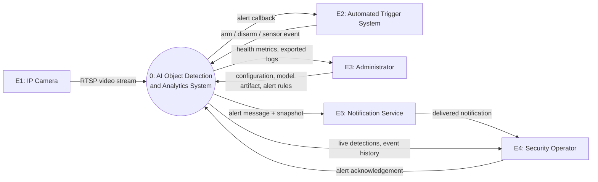
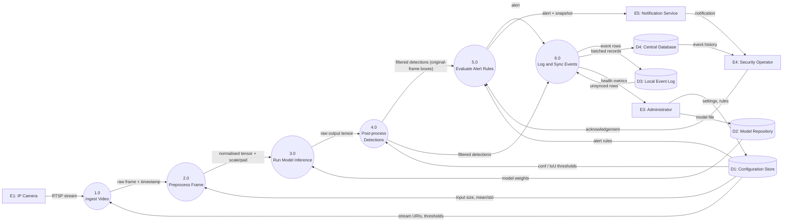
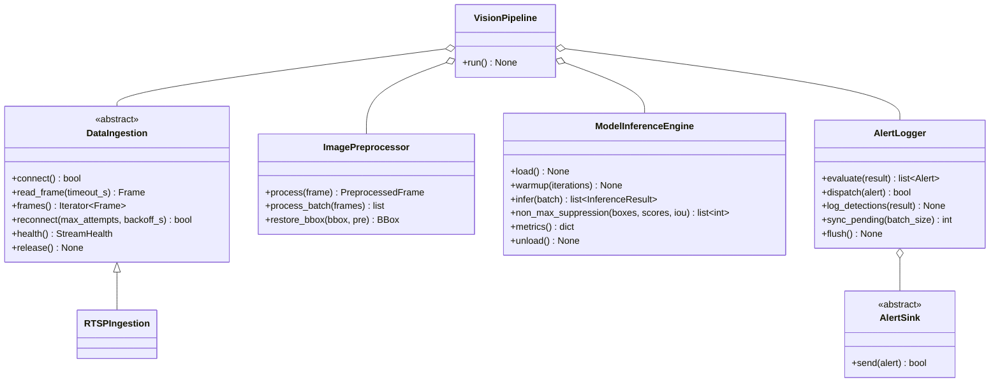
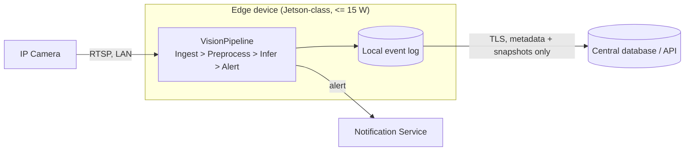

# System Design Specification: Vision Platform

**Course:** AI Project Design and Development (AI-316) | **Lab:** 02 | **Air University Islamabad**
**Version:** 1.0 | **Status:** Draft for review

---

## 1. Introduction

### 1.1 Purpose
This document specifies the requirements, boundaries, data flow and modular software architecture of **Vision Platform**, an edge-deployed computer-vision system. It is the single source of truth that implementation (`src/vision/`) must follow.

### 1.2 Scope and framing
One shared real-time pipeline (*ingest → preprocess → infer → post-process → log/alert*) serves two applications:

| Application | Model task | Used in |
|---|---|---|
| **A. Smart Automated Attendance** | Face detection + face recognition | Section 3 (Task 1) |
| **B. AI Surveillance / Object Detection Analytics** | Object (person, vehicle, ...) detection | Sections 4-6 (Tasks 2-4) |

Both applications reuse the same four modules; only the model and alert rules differ. This is why the architecture is modular (Section 6).

### 1.3 Glossary
| Term | Meaning |
|---|---|
| RTSP | Real Time Streaming Protocol, the camera transport |
| NMS | Non-Maximum Suppression, removes duplicate boxes |
| TAR / FAR | True Accept Rate / False Accept Rate (face verification) |
| mAP@0.5 | Mean Average Precision at IoU 0.5 (detection accuracy) |
| DFD | Data-Flow Diagram |

---

## 2. Requirements Notation
IDs: `FR-xx` functional, `NFR-xx` non-functional. Priority uses MoSCoW (M = Must, S = Should). Every requirement has a **measurable acceptance criterion** and a **verification method**, otherwise it is not testable.

---

## 3. Task 1: Requirements for the Smart Automated Attendance System

### 3.1 Functional requirements

| ID | Requirement | Acceptance criterion | Verification | Priority |
|---|---|---|---|---|
| FR-01 | **Face detection:** detect all frontal/near-frontal faces in each processed frame. | Detection latency <= 100 ms/frame at the edge; recall >= 97% on the validation set. | Benchmark script + labelled test set | M |
| FR-02 | **Face recognition:** match each detected face against enrolled embeddings and assign an identity or `unknown`. | Cosine similarity >= configurable threshold (default 0.60) to accept; ties resolved by highest score. | Unit test + verification set | M |
| FR-03 | **Attendance logging:** record one entry per person per class session with timestamp, camera ID, confidence. | No duplicate entry for same person+session; entry written <= 2 s after first confirmed recognition (>= 3 consistent frames). | Integration test with replayed video | M |
| FR-04 | **Database synchronization:** store records locally first, then sync to the central database, retrying on failure. | Zero record loss across a 30-minute network outage; sync completes <= 60 s after connectivity returns. | Fault-injection test | M |
| FR-05 | **Enrollment and reporting:** admin can enroll/remove students (>= 5 images each) and export attendance per course/date as CSV. | Enrollment <= 30 s/student; export of 1 semester (~50k rows) <= 10 s. | Functional test | S |

### 3.2 Non-functional requirements

| ID | Category | Requirement | Acceptance criterion | Verification | Priority |
|---|---|---|---|---|---|
| NFR-01 | Performance | Sustain real-time processing on the edge device. | **>= 15 FPS** end-to-end (capture to log) at 720p, one stream. | 10-min soak test | M |
| NFR-02 | Accuracy | Meet recognition-quality thresholds. | **TAR >= 95% at FAR <= 1%**; face detection mAP@0.5 >= 0.90. | Held-out evaluation | M |
| NFR-03 | Power / resources | Stay inside the edge power and memory budget. | Mean draw **<= 10 W**; RAM <= 2 GB; no thermal throttling after 1 h. | Power meter + `tegrastats` | M |
| NFR-04 | Privacy and security | Protect biometric data. | Only embeddings stored (no raw frames retained beyond the 2 s processing window); embeddings encrypted at rest (AES-256) and in transit (TLS 1.2+); documented consent; retention <= 1 academic year. | Code review + security checklist | M |
| NFR-05 | Reliability | Keep running through faults. | >= 99% uptime during class hours; auto-restart <= 30 s after crash; auto-reconnect to camera. | Chaos test (kill process, unplug camera) | S |

> **Design note:** attendance is a high-stakes identity decision. A liveness/anti-spoofing check (photo-of-a-photo attack) is flagged as a future requirement (`FR-06`, out of scope for this lab).

---

## 4. Task 2: System Boundary, Actors, and Input/Output Mapping (Surveillance Application)

### 4.1 Actors

| Actor | Type | Goals | Interacts via |
|---|---|---|---|
| **Security Operator** | Human, primary | Monitor live detections, acknowledge/dismiss alerts, review events | Dashboard / mobile notification |
| **Administrator** | Human, primary | Configure cameras, models, thresholds, alert rules; manage users; export logs | Admin console / config files |
| **IP Camera** | External system | Supplies video | RTSP |
| **Automated Trigger System** | External system | Fires scheduled/sensor-based activation (e.g. motion sensor, after-hours arming) and receives alert callbacks | MQTT / webhook |
| **Notification Service** | External system | Delivers alerts to humans | SMTP / push / webhook |

### 4.2 System boundary

| In scope (system owns) | Out of scope (external) |
|---|---|
| Stream ingestion and reconnect | Camera hardware, PoE, physical network |
| Preprocessing, inference, NMS | Model *training* (done offline; only the exported model is deployed) |
| Rule evaluation, alert generation | Delivery infrastructure of email/SMS providers |
| Local event store and sync | Central DB server administration |
| Operator-facing alert/event API | Video management system (VMS) / long-term video archive |

### 4.3 System inputs

| ID | Input | Source | Format / parameters | Rate / size |
|---|---|---|---|---|
| IN-1 | Video stream | IP camera | RTSP, H.264/H.265, 1280x720 (min) to 1920x1080, 15-30 FPS, up to 4 Mbps | continuous |
| IN-2 | Sensor/trigger signal | Automated Trigger System | MQTT JSON `{"camera_id","event","ts"}` | event-driven |
| IN-3 | System configuration | Administrator | YAML: camera URIs, model path, `conf_threshold`, `iou_threshold`, alert rules, zones | on change |
| IN-4 | Model artifact | Administrator / MLOps | ONNX or TensorRT engine, versioned, with SHA-256 checksum | 10-100 MB |
| IN-5 | Operator action | Security Operator | Acknowledge / dismiss alert (HTTP POST) | event-driven |

### 4.4 System outputs

| ID | Output | Consumer | Format / fields |
|---|---|---|---|
| OUT-1 | Detections | Internal / dashboard | `bbox (x1,y1,x2,y2)` in original-frame pixels, `class`, `confidence`, optional `track_id` |
| OUT-2 | Alert notification | Operator via Notification Service | JSON: `alert_id, rule_id, severity, camera_id, timestamp, message, snapshot_path` |
| OUT-3 | Log entries | Local DB then central DB | Row: `frame_id, camera_id, ts, label, confidence, bbox` |
| OUT-4 | Snapshot image | Operator | JPEG (quality 85) of the triggering frame with boxes drawn |
| OUT-5 | System health metrics | Administrator | FPS, latency p50/p95, dropped frames, reconnect count, memory |

### 4.5 Operational constraints

| ID | Constraint | Limit |
|---|---|---|
| C-1 | Memory footprint (pipeline process, edge device) | <= 2 GB RAM, <= 1.5 GB GPU memory |
| C-2 | Bandwidth: camera to edge (per stream) | <= 4 Mbps; LAN only |
| C-3 | Bandwidth: edge to cloud | <= 256 kbps average; **only metadata and snapshots leave the site, never continuous video** |
| C-4 | End-to-end alert latency (event to notification sent) | <= 2 s (P95) |
| C-5 | Frame buffer | <= 4 frames, drop-oldest policy (bounds latency and RAM) |
| C-6 | Offline operation | Local store must hold >= 7 days of events if uplink is down |
| C-7 | Power | <= 15 W for the edge device |
| C-8 | Model | Single-batch inference <= 60 ms (so 15 FPS has headroom for ingest and logging) |

---

## 5. Task 3: Data-Flow Diagrams

Diagrams are Mermaid and render natively on GitHub/GitLab. Notation: **rectangle** = external entity, **circle / rounded box** = process, **cylinder** = data store, **labelled arrow** = data flow.

### 5.1 Level 0: Context diagram



### 5.2 Level 1: Decomposition



### 5.3 Process dictionary

| Process | Input | Output | Maps to module |
|---|---|---|---|
| 1.0 Ingest Video | RTSP stream, stream URI | `Frame` | `DataIngestion` |
| 2.0 Preprocess Frame | `Frame` | `PreprocessedFrame` | `ImagePreprocessor` |
| 3.0 Run Model Inference | `PreprocessedFrame` batch | raw output tensor | `ModelInferenceEngine.infer` |
| 4.0 Post-process Detections | raw tensor | `list[Detection]` (thresholded, NMS, restored boxes) | `ModelInferenceEngine._postprocess` |
| 5.0 Evaluate Alert Rules | `InferenceResult`, rules | `list[Alert]` | `AlertLogger.evaluate / dispatch` |
| 6.0 Log and Sync Events | detections, alerts | DB rows | `AlertLogger.log_detections / sync_pending` |

**Balancing check:** every Level 0 flow (E1..E5 in/out) appears at Level 1 attached to a process; no flow was added or lost during decomposition.

---

## 6. Task 4: Modular Software Architecture

### 6.1 Design principles
1. **Single responsibility:** each module does one thing (table below).
2. **Contract-only coupling:** modules exchange only the dataclasses in `contracts.py`; no module imports another module.
3. **Swappable backends:** RTSP vs file source, ONNX vs TensorRT, email vs webhook are hidden behind abstract interfaces.
4. **Orchestration separated from logic:** `VisionPipeline` only wires modules together.
5. **Bounded resources:** small frame buffer with drop-oldest; batch size capped.

### 6.2 Module responsibilities

| Module | Responsibility | Does NOT do |
|---|---|---|
| `DataIngestion` | Connect, decode, timestamp, buffer, reconnect | Resize, inference |
| `ImagePreprocessor` | Letterbox resize, colour convert, normalise, CHW, box restoration | Model execution |
| `ModelInferenceEngine` | Load/warm up model, batch inference, threshold, NMS, label map | Alerting, storage |
| `AlertLogger` | Rule evaluation, cooldown, dispatch, local log, sync | Capturing, inference |
| `VisionPipeline` | Orchestrate the loop, guarantee clean shutdown | Any CV logic |

### 6.3 Class diagram



### 6.4 Interface specification

Full skeleton code lives in `src/vision/` (compiles; `NotImplementedError` marks what students implement next).

| Module / method | Inputs | Returns |
|---|---|---|
| `DataIngestion.connect()` | none (uses `source_uri`) | `bool` |
| `DataIngestion.read_frame(timeout_s)` | `float` | `Optional[Frame]` |
| `DataIngestion.frames()` | none | `Iterator[Frame]`, raises `StreamError` |
| `DataIngestion.health()` | none | `StreamHealth` |
| `ImagePreprocessor.process(frame)` | `Frame` | `PreprocessedFrame` (CHW float32 + scale + pad) |
| `ImagePreprocessor.restore_bbox(bbox, pre)` | `BBox`, `PreprocessedFrame` | `BBox` (original pixels, clipped) |
| `ModelInferenceEngine.load()` | none | `None`, raises `ModelLoadError` |
| `ModelInferenceEngine.infer(batch)` | `Sequence[PreprocessedFrame]` | `List[InferenceResult]` (same order) |
| `ModelInferenceEngine.non_max_suppression(...)` | `ndarray Nx4`, `ndarray N`, `float` | `List[int]` kept indices |
| `AlertLogger.evaluate(result)` | `InferenceResult` | `List[Alert]` |
| `AlertLogger.dispatch(alert)` | `Alert` | `bool` |
| `AlertLogger.log_detections(result)` | `InferenceResult` | `None` |
| `AlertLogger.sync_pending(batch_size)` | `int` | `int` rows synced |

### 6.5 Core data contracts (excerpt from `contracts.py`)

```python
@dataclass(frozen=True)
class Frame:
    frame_id: int; camera_id: str; timestamp_ns: int
    image: np.ndarray            # H x W x 3, BGR, uint8

@dataclass
class PreprocessedFrame:
    source: Frame
    tensor: np.ndarray           # 3 x H x W, float32
    scale: float
    pad: Tuple[int, int]         # (pad_left, pad_top)

@dataclass
class Detection:
    bbox: BBox; class_id: int; label: str
    confidence: float; track_id: Optional[int] = None
```

### 6.6 Requirement traceability

| Requirement | Satisfied by |
|---|---|
| FR-01, FR-02 (face detect/recognise) | `ModelInferenceEngine` with face models (config swap) |
| FR-03 (attendance log) | `AlertLogger.log_detections` + session de-dup rule |
| FR-04 (sync) | `AlertLogger.sync_pending` (offline-first local DB) |
| NFR-01 (15 FPS) | Drop-oldest buffer in `DataIngestion`, batch cap, warm-up |
| NFR-03 / C-1 (memory/power) | Buffer <= 4 frames, `unload()`, ONNX/TensorRT backend |
| NFR-04 (privacy) | Only embeddings/metadata persisted; snapshots only on alert |
| C-3 (bandwidth) | Only `Alert` + log rows leave the edge |
| NFR-05 (reliability) | `DataIngestion.reconnect`, `VisionPipeline` try/finally |

---

## 7. Deployment View



## 8. Repository Layout

```
vision-platform/
├── ARCHITECTURE.md
└── src/vision/
    ├── __init__.py
    ├── contracts.py              # shared dataclasses and exceptions
    ├── data_ingestion.py         # DataIngestion, RTSPIngestion
    ├── image_preprocessor.py     # ImagePreprocessor, PreprocessConfig
    ├── model_inference_engine.py # ModelInferenceEngine, InferenceConfig
    ├── alert_logger.py           # AlertLogger, AlertRule, AlertSink
    └── pipeline.py               # VisionPipeline orchestrator
```

## 9. Risks and Open Questions

| # | Item | Mitigation / next step |
|---|---|---|
| 1 | Face spoofing (printed photo) | Add liveness requirement `FR-06` |
| 2 | 15 FPS target depends on the chosen edge board and model size | Benchmark candidate models before freezing NFR-01 |
| 3 | Biometric data legal basis (consent, retention) | Confirm with the university policy owner |
| 4 | Threshold values (0.60 cosine, 0.40 conf) are initial guesses | Tune on a held-out campus dataset |
